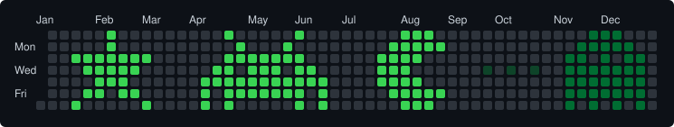
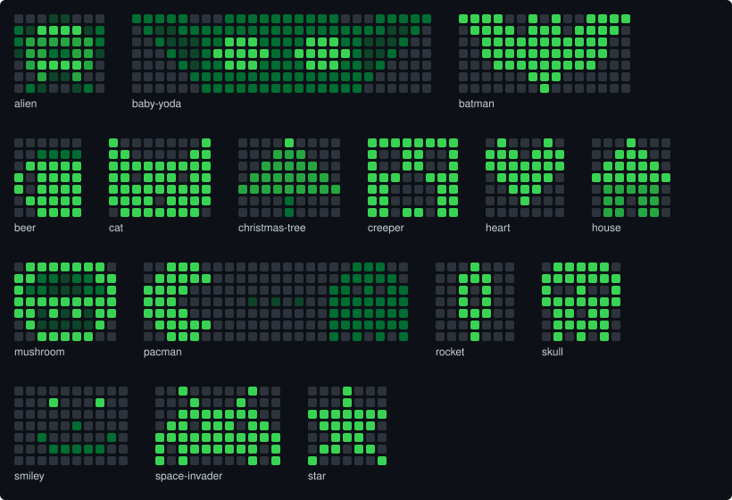

# pretty-github

**Draw pixel art on your GitHub contribution graph, and preview it on your real graph before
a single commit is made.**



Pick a pattern and a week, look at the preview, then let the tool make the backdated commits
and push them. You can also turn any picture into a pattern by pasting its URL.

## Why this one

There are plenty of gitfiti tools (see [Honorable mentions](#honorable-mentions)). This one:

- **Previews on your real graph.** It reads your contributions through the GitHub CLI and
  shows the graph now, with GitHub's own shades, and after the drawing. It also warns when the
  drawing lands on days that already have contributions.
- **Turns pictures into patterns.** Give it a PNG, JPEG, GIF or WebP, as a file or a URL, and
  it saves a 7-row pattern you can preview straight away.
- **Keeps patterns as plain text files.** Seven lines of digits and dots, easy to draw, edit
  and share.
- **Asks before it changes anything.** It asks before committing and again before pushing,
  and prints the command that undoes the commits. It needs no token: it pushes with your
  normal git login.

## Quick start

You need [uv](https://docs.astral.sh/uv/), make (on Windows: `winget install ezwinports.make`)
and the [GitHub CLI](https://cli.github.com/), logged in with `gh auth login`.

1. **Get your own copy.** Click **Use this template**, or clone this repo and push it to a new
   repo of yours. It must not be a fork: GitHub does not count commits in forks.

2. **Preview a pattern.** Nothing is committed. `START` is the top-left cell of the pattern:
   a Sunday, written YYYY-MM-DD.

   ```console
   make preview PATTERN=space-invader START=2022-03-06
   ```

3. **Draw it.** This shows the same preview, then makes the commits on `main` and pushes them,
   asking before each step.

   ```console
   make commits PATTERN=space-invader START=2022-03-06
   ```

   Your profile can take a few minutes to update.

Run `make` to list every command.

## Patterns



Each pattern is a text file in [`patterns/`](patterns), named after the pattern:
`patterns/heart.txt` is `PATTERN=heart`. It has 7 lines, one per weekday from Sunday to
Saturday. A digit is the number of commits that day and a dot is none. Lines starting with
`#` are comments.

```text
.1...1.
111.111
1111111
.11111.
..111..
...1...
.......
```

Add a file, run `make preview` to see it, and `make test` to check it. `make gallery`
redraws the pictures in this README.

### From a picture

Paste a URL or give a file. Quote the URL, because PowerShell does not accept `&` unquoted.

```console
make image IMAGE="https://example.com/cat.png" NAME=cat
make preview PATTERN=cat START=2022-03-06
```

The picture is cropped and shrunk to 7 rows, and its darkness becomes the shades. Light and
transparent parts stay blank. Add `INVERT=1` for a light drawing on a dark background. Seven
rows is tiny, so simple, high-contrast pictures work best: icons, emoji and pixel art.

## How it works

- The graph has one column per week and one row per weekday, Sunday at the top, so a
  pattern has to start on a Sunday.
- Each commit is empty and dated at noon UTC on its day, so it lands on the right day in
  every timezone.
- GitHub picks a square's shade relative to your own busiest days. The same pattern can
  therefore come out lighter or darker on different graphs, which is why the preview reads
  your real graph. GitHub does not document the exact rule, so the "after" shades are an
  estimate. Quiet years give the most faithful drawings.

GitHub only counts the commits if:

- they are on the repo's default branch;
- your git email (`git config user.email`) is verified on your account;
- the repo is not a fork;
- for a private repo, "private contributions" is switched on in your profile.

## Development

Python 3.13 with uv, ruff and pytest. `make test`, `make lint` and `make format` cover the
usual work. Run `make` for the full list.

## Honorable mentions

- [gitfiti](https://github.com/gelstudios/gitfiti) main source of inspiration - notably for this list :)
- [PixelHub](https://github.com/behind24proxies/PixelHub), where you can draw what you want, download a file, and then reproduce it in commit
- [Vincent Van Git](https://github.com/jh3y/vincent-van-git) Vincent, which offers a [very slick web ui](https://vincent-van-git.netlify.app/) to generate a gitfiti script
- [github-calendar-customerizer](https://github.com/ZachSaucier/github-calendar-customizer) from ZachSaucier, another very [nice web GUI](https://codepen.io/ZachSaucier/full/PzVRBy) for generating gitfiti templates
- [git-art](https://github.com/jamesjarvis/git-art) from jamesjarvis, a work-alike web based [editor GUI](https://jamesjarvis.github.io/git-art/) that generates the script too
- [Pikesley's](https://github.com/pikesley) Pokrovsky, which offers Github History Vandalism [as a Service!](http://pokrovsky.herokuapp.com/)
- [PSVandalism](https://github.com/DenisBalan/PSVandalism) Wrapper around Pokrovsky, which makes possible vandalising Github History from Powershell
- [github-board](https://github.com/bayandin/github-board) commits gitfiti from easy templates
- [ghdecoy](https://github.com/tickelton/ghdecoy) fills the contribution graph with random data (sneaky!)
- [Gitfiti Painter](http://codepen.io/cbas/pen/vOXeKV) visual drawing tool for artists to easily create templates
- [git-draw](https://github.com/ben174/git-draw) a Chrome extension which will allow you to freely draw on your commit map(!)
- [github-jack](https://github.com/tardypad/github-jack) a pure bash version with space invaders and shining creepypasta
- [github-graffiti](https://github.com/mavrk/github-graffiti) a GUI editor with a bash script to allow custom designs on your commit map
- [Paint GitHub](https://paintgithub.com/) is the most convenient way to paint your GitHub contribution graph!
- [contribution-pixel-messages](https://github.com/abulvenz/contribution-pixel-messages) generates a date plan from an editable GUI
- Seen something else? Submit a pull request or open an issue!

## License

[GPL-3.0](LICENSE)
